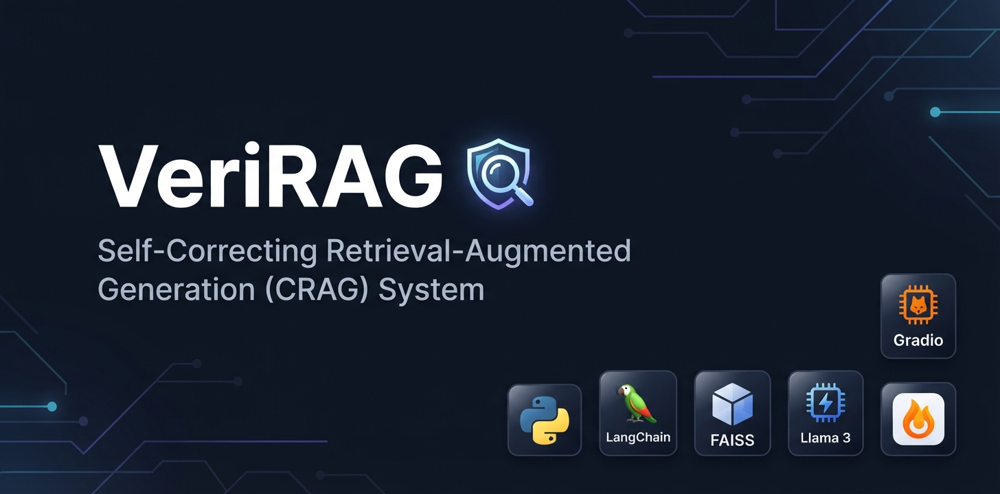

<p align="center">
  
</p>

# 🛡️ VeriRAG: Corrective Retrieval-Augmented Generation (CRAG) System

[](https://python.org)
[](https://langchain.com)
[](https://github.com)
[](https://groq.com)
[](https://gradio.app)

**VeriRAG** is an end-to-end **Corrective Retrieval-Augmented Generation (CRAG)** pipeline built with **LangChain**, **FAISS**, **Groq (Llama-3.3-70B)**, and **Gradio**. Unlike standard RAG systems that blindly trust retrieved chunks, VeriRAG evaluates document relevance before generation, automatically rewrites weak queries, and prevents hallucinations by refusing to answer when verified context is missing.

---

## ✨ Key Features
- **Document Ingestion Pipeline:** Supports multi-file `PDF` and `TXT` uploads with automated text cleaning, metadata tracking (filename & page number), and recursive semantic chunking.
- **Semantic Vector Search:** Uses `sentence-transformers/all-MiniLM-L6-v2` embeddings indexed in a fast local **FAISS** vector store.
- **Self-Evaluation (Relevance Grader):** Grades every retrieved chunk (`YES` / `NO`) before passing context to the generator.
- **Corrective Query Rewriting:** Automatically optimizes weak or ambiguous user queries and triggers a second retrieval pass when initial results are irrelevant.
- **Hallucination Prevention & Citations:** Generates answers strictly from verified chunks with exact page-level citations, or safely declines unanswered questions.
- **Transparent Gradio UI:** Displays real-time step-by-step evaluation and correction logs alongside the interactive chat interface.

---

## 🔄 Architecture Workflow

```text
User Question ──► Initial FAISS Retrieval ──► LLM Relevance Grader
                                                    │
                    ┌───────────────────────────────┴───────────────────────────────┐
                    ▼ (Relevant Chunks Found)                                       ▼ (Weak / Irrelevant)
        Grounded Answer + Sources                                     Rewrite Query & Re-Retrieve
                                                                                    │
                                                                    ┌───────────────┴───────────────┐
                                                                    ▼ (Verified)                    ▼ (Still Missing)
                                                        Grounded Answer + Sources       Safe Fallback ("Not Found")
```

---

## 📁 Project Structure

```text
VeriRAG-Corrective-RAG-System/
├── banner.png             # Project header banner
├── app.py                 # Main Gradio web interface & application entry point
├── rag_engine.py          # Ingestion pipeline, FAISS vector store, & Corrective RAG logic
├── requirements.txt       # Python dependencies
├── .gitignore             # Ignored cache, environment, and temporary files
└── README.md              # Project documentation
```

---

## 🚀 How to Run Locally

1. **Clone the repository:**
   ```bash
   git clone https://github.com
   cd VeriRAG-Corrective-RAG-System
   ```

2. **Install dependencies:**
   ```bash
   pip install -r requirements.txt
   ```

3. **Set your Groq API key (optional, or enter directly in the UI):**
   ```bash
   export GROQ_API_KEY="your_groq_api_key_here"
   ```

4. **Launch the Gradio web app:**
   ```bash
   python app.py
   ```
